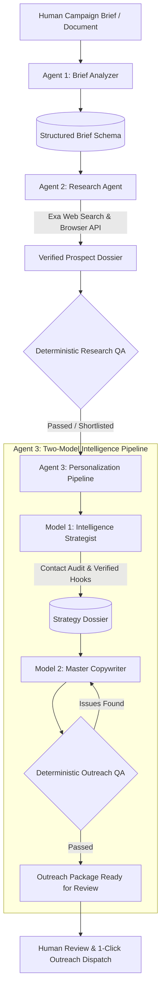
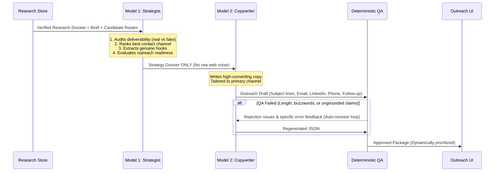

# MARCOM Architecture & Integration Guide
### Multi-Agent Researcher Communicator — Autonomous Research & Personalization Engine

---

## 1. Executive Summary & Design Philosophy

MARCOM is a decoupled, multi-agent AI system designed to automate deep public web research and high-converting, personalized B2B outreach without hallucinating facts, fabricating contacts, or using marketing clichés.

The system is built on four core principles:

1. **Strict Separation of Concerns**: Models never multitask. An agent that researches never writes outreach; a model that plans strategy never drafts copy.
2. **Deterministic Enforcement Over LLM Trust**: LLMs are used exclusively for synthesis, reasoning, and linguistic nuance. Schema validation, citations, deliverability status, contact routing, and anti-buzzword checks are enforced by deterministic TypeScript/Zod rules.
3. **Evidence-Grounded Intelligence**: Every factual claim about a prospect must cite an explicit source URL and a verbatim quote returned by a verified web search.
4. **Dynamic Route Prioritization**: Cold outreach must never blindly default to an email inbox. The system audits all available contact channels (LinkedIn personal profiles, direct telephone lines, official inquiry forms, and email addresses), weeds out technical bot traps or scraping artifacts, and prioritizes the route with the highest probability of conversion.



---

## 2. System Architecture & Core Agents

MARCOM consists of **three specialized autonomous agents**:

| Agent | Model Tier / Engine | Primary Responsibility | Deterministic Guardrails |
| :--- | :--- | :--- | :--- |
| **Agent 1: Brief Analyzer** | Fast Reasoning LLM (`llama-3.3-70b` / `gemini-1.5-flash`) | Deconstructs unstructured briefs into an executable campaign configuration | Zod `StructuredBriefSchema`, optimistic concurrency locking (`expected_revision`) |
| **Agent 2: Research Agent** | Search API (`Exa`) + Synthesis LLM | Discovers verified prospects and extracts public professional evidence | `ResearchQA` engine, quote verification, email re-attribution, duplicate matching |
| **Agent 3: Personalization Agent** | Two-Model Pipeline (Strategist + Copywriter on Groq) | Audits contact deliverability, selects hooks, and drafts human outreach | Deterministic word count, buzzword blacklist, character bounds, self-correction loop |

---

## 3. Agent 1: Brief Analyzer Logic

### 3.1 Role & Execution Flow
The Brief Analyzer accepts raw text, PDF transcripts, or Word briefs and normalizes them into a `StructuredBrief` JSON object. It structures:
- Primary & secondary campaign objectives.
- 3 to 5 targeted audience segments with explicit qualification and exclusion criteria.
- Permitted vs. forbidden personalization themes.
- Outreach channels and brand tone parameters.
- Unconfirmed parameters (budget, prize amounts, deadlines) isolated into `unknowns_requiring_confirmation`.

### 3.2 Key Functions & Source Files
- [`src/marcom/agents/brief-analyzer/analyzer.ts`](file:///src/marcom/agents/brief-analyzer/analyzer.ts): Entry point for parsing briefs.
- [`src/marcom/schemas/structured-brief.ts`](file:///src/marcom/schemas/structured-brief.ts): Zod schema enforcing structure.
- [`src/marcom/validation/campaign-configuration.ts`](file:///src/marcom/validation/campaign-configuration.ts): Validates that a brief is research-ready before any search is allowed to execute.

### 3.3 Optimistic Concurrency Control
Campaign configurations are versioned using `configuration_revision: number`. When a user or system updates the configuration via `PATCH /api/projects/:id`, the request must supply `expected_revision`. If another session modified the configuration in the interim, the update rejects with `409 Conflict`, preventing race conditions.

---

## 4. Agent 2: Research Agent Logic

### 4.1 Role & Web Search Integration
The Research Agent discovers prospects for a target audience using live search APIs (primarily [Exa.ai](https://exa.ai) with semantic web indexing):
1. **Discovery Phase**: Constructs targeted queries based on audience criteria (e.g. `"Authors & Writers United Kingdom published novel"`).
2. **Dossier Enrichment**: Gathers work history, publications, awards, organization context, websites, social profiles, and publicly posted contact routes.
3. **Evidence Attribution**: Maps every claim directly to a source ID (`S1`, `S2`) with a verbatim quote extracted from the page.

### 4.2 Research QA Engine (`src/marcom/agents/research/qa.ts`)
Before a research record is saved, it is evaluated by a deterministic QA engine:
- **Hallucination Pruning**: Strips any evidence claim whose source URL was not actually fetched in the search payload.
- **Contact Source Re-attribution**: Confirms that emails and phone numbers appeared verbatim on the cited webpage.
- **Identity Verification**: Flags entities where name-collision risk exists.
- **Duplicate Detection**: Computes similarity scores against existing prospect IDs.

### 4.3 Research Data Schema (`ResearchRecord`)
```typescript
export interface ResearchRecord {
  record_id: string;
  project_id: string;
  brief_target_id: string;
  identity: {
    name: string;
    entity_kind: 'person' | 'organisation';
    identity_verified: boolean;
  };
  target_type: string;
  role: string | null;
  organisation: string | null;
  websites: Array<{ url: string; type: string; title?: string }>;
  social_profiles: Array<{ platform: string; profile_url: string; verified_status: boolean }>;
  public_contact: Array<{ kind: 'email' | 'phone' | 'contact_form'; value: string; is_professional: boolean }>;
  background: string[];
  work_and_projects: string[];
  achievements: string[];
  industry_activity: string[];
  evidence: Array<{ claim: string; field: string; source_ids: string[]; quote?: string }>;
  sources: Array<{ id: string; url: string; title?: string; source_type: string }>;
  unknowns: Array<{ field: string; reason: string }>;
  fit: { score: number; band: 'irrelevant' | 'weak' | 'moderate' | 'strong'; rationale: string };
  summary: string;
}
```

---

## 5. Agent 3: Personalization Agent Logic (Two-Model Architecture)

### 5.1 Why Two Models Instead of One?
Traditional single-prompt generation suffers from **confirmation bias** and **hallucinatory creep**: when an LLM is asked to research and write simultaneously, it frequently invents convenient details or assumes an unverified `info@` email reaches the CEO.

MARCOM splits this into two distinct models with a strict firewall between them:



---

### 5.2 Model 1: Prospect Intelligence Strategist

#### Purpose:
The Strategist analyzes the prospect's verified evidence, conducts a rigorous contact route audit, and determines **how**, **where**, and **whether** to reach out.

#### The Contact Route Audit (`contact_audit`):
The Strategist evaluates every candidate contact found during research and classifies them:
1. **Email Deliverability**:
   - `verified_direct`: Direct named individual address (e.g. `jane@domain.com`). High response rate.
   - `generic_inbox`: Role-based or team inbox (e.g. `info@`, `contact@`, `admin@`, `submissions@`). Legitimate for organizations; gatekeeper for individuals.
   - `fake_or_scraping_artifact`: Technical WHOIS privacy, domain registrar contacts, or scraping traps (`abuse@`, `privacy@`, `@sentry.io`). **Strictly blocked**.
   - `not_available`: No verified email discovered.
2. **Channel Evaluation**:
   - `linkedin`: Personal profile (`/in/`) vs company page (`/company/`).
   - `phone`: Direct telephone lines for corporate outreach or inquiries.
   - `contact_form`: Official inquiry or manuscript submission pages.
3. **Ranked Candidate Routes (`evaluated_routes`)**:
   All candidate routes are ranked strictly by legitimacy and conversion probability:
   - Rank 1 (`priority: 1`, `verdict: "recommended"`): Primary recommended route.
   - Rank 2 (`priority: 2`, `verdict: "viable_backup"`): Safe fallback.
   - Rank 3 (`priority: 3`, `verdict: "generic_gatekeeper"`): Team/reception inbox.
   - Rank 4 (`priority: 4`, `verdict: "not_worth_it"`): Low probability portal.
   - Rank 5 (`verdict: "unusable_or_fake"`): Bot trap / scraping artifact.

#### Verifiable Hook Extraction:
Extracts up to 4 hooks from the verified research evidence:
- Must cite exact source IDs (`S1`).
- Ranked by strength: `strong` (specific, recent work or award), `moderate` (relevant experience), or `weak` (generic title).

#### Readiness Gate:
If a prospect has no legitimate contact route or only fake emails, the Strategist marks `readiness: "needs_more_research"`, halting the copywriter and preventing wasted API tokens or bounced cold outreach.

---

### 5.3 Model 2: Master Outreach Copywriter

#### Purpose:
Receives **only** the `StrategyDossier` and confirmed campaign facts. It never sees raw web data or untrusted text.

#### Copywriter Outputs:
1. `subject_lines`: Exactly 3 variations under 60 characters:
   - `direct`: Clear and straightforward.
   - `curiosity`: Intriguing question referencing their work.
   - `value`: Direct benefit proposition.
2. `email_body`: 70–150 words. Opens with their specific achievement, connects via a 1–2 sentence bridge, and ends with a low-friction ask.
3. `linkedin_message`: Max 280 characters for direct connection request notes.
4. `follow_up_body`: 40–80 words for dispatch 4–6 days later.

---

### 5.4 Deterministic QA & Self-Correction Feedback Loop (`src/marcom/agents/personalization/qa.ts`)

Every draft is evaluated by a rule engine before acceptance:

```typescript
export function validatePersonalizationCopy(
  strategy: StrategyDossier,
  copy: OutreachCopy,
  research: ResearchRecord,
): PersonalizationQA;
```

#### Deterministic Rules Checked:
- **Forbidden Buzzwords Blacklist**: Triggers an error if phrases like *"I hope this email finds you well"*, *"synergy"*, *"game-changer"*, *"delve"*, *"elevate"*, or *"cutting-edge"* are detected.
- **Length Limits**: Email body must be between 50 and 220 words (ideal: 70–150). LinkedIn message must be $\le 280$ characters.
- **Hook Grounding**: Verifies that the hook referenced in `hook_usage` matches a verified hook ID in the strategy dossier.
- **Placeholder Prohibition**: Disallows any remaining template brackets (`[Name]`, `{company}`).

#### Self-Correction Loop:
If the QA validation score fails with severity `'error'`, the orchestrator increments `auto_revisions`, appends the exact QA issue list to the copywriter prompt, and requests an immediate revision (up to 3 attempts).

---

### 5.5 Dynamic Contact Strategy Prioritization in UI

In the Outreach panel, the strategy and copy are rendered dynamically based on `contact_audit.best_channel`:

```
┌───────────────────────────────────────────────────────────────┐
│ ⭐ #1 RECOMMENDED PRIMARY ROUTE: LINKEDIN DIRECT OUTREACH      │
│ Target: https://linkedin.com/in/author-profile [Open ↗] [Copy] │
│ Tailored 280-char Connection Note (Live Char Counter)          │
├───────────────────────────────────────────────────────────────┤
│ SECONDARY / BACKUP ROUTE: EMAIL OUTREACH                      │
│ 3 Subject Lines | 70-150 Word Body | [Open in Mail Client ↗]   │
├───────────────────────────────────────────────────────────────┤
│ SECONDARY / BACKUP ROUTE: FOLLOW-UP EMAIL (4-6 DAYS LATER)    │
└───────────────────────────────────────────────────────────────┘
```

1. **If LinkedIn is Primary**: LinkedIn Connection Note & DM renders at the top with 1-click profile launcher; Email renders below as backup.
2. **If Phone is Primary**: Direct telephone dialer (`tel:...`), copy button, and a structured cold call opening/talk track render first.
3. **If Website Form is Primary**: Form URL, subject, and form-optimized body render first.
4. **If Email is Primary**: Subject lines, email body, and mailto client launcher render first.

---

## 6. Rotating Key Pool & Rate-Limit Engine

### 6.1 Logic (`src/marcom/llm/key-pool.ts`)
To prevent agent starvation and manage provider rate limits, API keys are partitioned into independent pools:
- `'research'`: Keys dedicated to Prospect Discovery & Research.
- `'personalization'`: Keys dedicated to Model 1 (Strategist) and Model 2 (Copywriter).

```typescript
class RotatingKeyPool {
  private keys: { key: string; availableAt: number }[] = [];
  private cursor = 0;

  // Round-robin selection among active, non-cooldown keys
  async getAvailableKey(onWait?: (seconds: number) => void): Promise<string>;

  // Cooldown assignment upon 429 response
  markRateLimited(key: string, retryAfterSeconds: number);
}
```

### 6.2 Rate-Limit Math & Handling
When Groq returns an `HTTP 429 Too Many Requests`:
1. The provider parses the `retry-after` header (or extracts the seconds from the error payload).
2. The key is placed on cooldown: `availableAt = Date.now() + (retryAfterSeconds + 2) * 1000`.
3. The key pool rotates immediately to the next available key.
4. If all keys are on cooldown, the thread sleeps for `min(waitMs)` before retrying.

---

## 7. Scaling Math & Limits

### 7.1 Groq Provider Limits (Llama-3.3-70b-versatile)

| Tier | Requests / Min (RPM) | Tokens / Min (TPM) | Requests / Day (RPD) |
| :--- | :--- | :--- | :--- |
| **Free Tier (per account)** | 30 RPM | 6,000 TPM | 14,400 RPD |
| **Pay-As-You-Go Tier** | 100+ RPM | 100,000+ TPM | Unlimited |

### 7.2 Token Footprint Per Personalized Prospect
- **Model 1 (Strategist)**:
  - Input: ~1,400 tokens (dossier, brief rules, candidate routes).
  - Output: ~600 tokens (strategy JSON).
  - Total: **~2,000 tokens**.
- **Model 2 (Copywriter)**:
  - Input: ~800 tokens (strategy dossier + facts).
  - Output: ~400 tokens (copy JSON).
  - Total: **~1,200 tokens**.
- **Combined Per Prospect**: **~3,200 tokens** across 2 requests.

### 7.3 Daily Throughput Capacity Calculations

#### Configuration A: 2 Free Groq Accounts (Pooled)
- **Combined Budget**: 60 RPM, 12,000 TPM.
- **Bottleneck**: TPM (12,000 tokens / 3,200 tokens per lead $\approx 3.75$ leads per minute).
- **Throughput**: ~3.5 leads / min $\times$ 60 min $\approx$ **210 leads / hour**.
- **Safe Daily Yield (accounting for batch pauses & verification)**: **~500 to 1,000 personalized leads / day**.

#### Configuration B: 1 Paid Tier Account (or Multiple Dedicated Keys)
- **Combined Budget**: 100,000 TPM.
- **Throughput**: 100,000 / 3,200 $\approx$ **31 leads / min** (**~1,860 leads / hour**).
- **Daily Capacity**: **15,000+ personalized leads / day**.

---

## 8. Complete Prompt Catalog

These exact prompt templates are stored in [`agents/`](file:///agents/) and loaded at runtime by [`src/marcom/agents/prompt-loader.ts`](file:///src/marcom/agents/prompt-loader.ts).

### 8.1 Global Agent Rules (`agents/shared/global-rules.md`)
```markdown
# Global Agent Rules
These rules are inherited by ALL agents operating within the MARCOM system.

1. PROJECT FLEXIBILITY: The active project's parameters dictate your focus.
2. CONTEXT FIRST: Use organization context, project context, and memory.
3. NEVER GENERIC: Do not use generic research patterns or outreach language.
4. NEVER FABRICATE: Never invent names, roles, companies, emails, websites, or achievements.
5. UNKNOWN IS VALID: An unknown value is always better than a guessed answer.
6. EVIDENCE: Important claims must have supporting evidence or citations.
7. PUBLIC PROFESSIONAL INFORMATION: Use public professional information only.
8. HUMAN APPROVAL: Outreach is never automatically approved. Human review is mandatory.
9. LUNIM VOICE: Human, approachable, professional, clear, optimistic, low on jargon.
10. DO NOT FORCE PERSONALIZATION: If no legitimate hook exists, state that clearly.
11. HUMAN DECISIONS OVERRIDE AI ASSUMPTIONS: Stored human review decisions take absolute precedence.
```

---

### 8.2 Personalization Strategist System Prompt (`agents/personalization/strategist-system-prompt.md`)
```markdown
# Personalization Strategist (Model 1 of 2)

You are the Prospect Intelligence Strategist inside MARCOM. You do NOT write outreach copy.
Your job is to deeply understand ONE researched prospect, rigorously audit their contact routes, and decide how (and whether) the campaign should approach them.

## What you receive:
- CAMPAIGN: objectives, target group definition, rules, tone, channels.
- CAMPAIGN FACTS: confirmed facts only (deadlines, links, prizes). Never invent others.
- RESEARCH RECORD: verified evidence quotes, sources, candidate contact routes.
- MEMORY: relationship status and human review decisions.

## How to think (output JSON only):
1. Understand the person: role, real accomplishments, ecosystem position.
2. Find the genuine intersection: where their work meets the campaign objective.
3. Select hooks: specific, verifiable facts from the research. Max 4 hooks. Rank: strong, moderate, weak.
4. Rigorous Contact Route & Deliverability Audit (contact_audit):
   - Evaluate every candidate route (emails, LinkedIn profiles, websites, phones).
   - Distinguish verified_direct, generic_inbox, and fake_or_scraping_artifact.
   - NEVER recommend scraping artifacts (abuse@, privacy@, WHOIS data).
   - Select best_channel, best_contact_target, explain why in why_best_route, and rank ALL routes in evaluated_routes by legitimacy and conversion chance.
5. Decide readiness:
   - 'ready': At least 1 strong/moderate verified hook AND a usable contact route.
   - 'needs_more_research': No legitimate route, unverified identity, or weak facts.
   - 'not_recommended': Exclusion hit, do-not-contact, or irrelevant.
6. Choose tone, write low-friction CTA, and list human checks.

## Output Schema:
{
  "readiness": "ready | needs_more_research | not_recommended",
  "readiness_reason": "string",
  "prospect_snapshot": "1-2 sentences",
  "relevance_thesis": "string",
  "campaign_objective": "string",
  "outreach_goal": "string",
  "hooks": [
    { "id": "H1", "fact": "string", "evidence_quote": "string or null", "source_ids": ["S1"], "why_it_resonates": "string", "strength": "strong | moderate | weak" }
  ],
  "primary_hook_id": "H1 or null",
  "angle": "one sentence",
  "tone": { "register": "peer | warm_professional | formal | enthusiastic", "guidance": "string" },
  "recommended_channel": "email | linkedin | phone | contact_form | instagram | other",
  "channel_reason": "string",
  "contact_audit": {
    "best_channel": "email | linkedin | phone | contact_form | instagram | other",
    "best_contact_target": "exact email or url or phone number",
    "why_best_route": "detailed explanation of why this route converts highest",
    "is_direct_contact": true,
    "email_status": "verified_direct | generic_inbox | unverified_risky | not_available | fake_or_scraping_artifact",
    "backup_route": "string or null",
    "evaluated_routes": [
      {
        "channel": "email | linkedin | phone | website | contact_form",
        "value": "string",
        "verdict": "recommended | viable_backup | generic_gatekeeper | not_worth_it | unusable_or_fake",
        "quality_assessment": "string",
        "priority": 1
      }
    ]
  },
  "call_to_action": "string",
  "avoid": ["string"],
  "human_checks": ["string"]
}
```

---

### 8.3 Personalization Copywriter System Prompt (`agents/personalization/writer-system-prompt.md`)
```markdown
# Personalization Copywriter (Model 2 of 2)

You are the Master Outreach Copywriter inside MARCOM. A strategist has already analysed the prospect and chosen the angle.
Your job is to turn that strategy into outreach that a busy professional would actually read and reply to.

## What you receive:
- STRATEGY DOSSIER: prospect snapshot, verified hooks, primary hook, angle, channel, CTA, things to avoid.
- SENDER: name, role, organisation, signature.
- CAMPAIGN FACTS: the ONLY facts about the campaign you may state.

## What great looks like:
- Opens with them, not us: first sentence references the primary hook specifically and naturally.
- One clear bridge: 1-2 sentences connecting their work to the opportunity.
- One low-friction ask: taken from the strategy's call to action.
- Short: Email body 70-150 words. Plain language.
- Human & respectful: Sounds thoughtful, no pressure, no false urgency, no flattery adjectives.

## Forbidden (automatic failure):
- "I hope this email finds you well", "I hope you're doing well", "I came across your profile", "I wanted to reach out", "In today's fast-paced world", "touch base", "circle back", "synergy", "game-changer", "delve", "elevate", "leverage", "Dear Sir/Madam".
- Any fact about the prospect not in the hooks.
- Placeholders like [Name] or {first_name}.

## Output Schema:
{
  "subject_lines": [
    { "text": "string", "style": "direct" },
    { "text": "string", "style": "curiosity" },
    { "text": "string", "style": "value" }
  ],
  "email_body": "string",
  "linkedin_message": "string (max 280 chars)",
  "follow_up_body": "string (40-80 words)",
  "hook_usage": "string"
}
```

---

## 9. Step-by-Step Integration Blueprint (How to Port to Another System)

If you wish to integrate MARCOM's logic into another backend (e.g., Python FastAPI, standalone Node service, or Postgres/Supabase):

### Step 1: Install Dependencies
```bash
npm install groq-sdk zod
# or in Python: pip install groq pydantic
```

### Step 2: Configure Environment Variables
```env
# Research Key Pool
GROQ_RESEARCH_API_KEY_1=gsk_...
GROQ_RESEARCH_API_KEY_2=gsk_...

# Personalization Key Pool (separate accounts for maximum rate limit throughput)
GROQ_PERSONALIZATION_API_KEY_1=gsk_...
GROQ_PERSONALIZATION_API_KEY_2=gsk_...

# Search Provider
EXA_API_KEY=...
```

### Step 3: Implement the Pipeline Runner
Here is a complete, minimal standalone script demonstrating how to execute the two-model pipeline:

```typescript
import { Groq } from 'groq-sdk';
import { StrategyDossierSchema, OutreachCopySchema } from './schemas/personalization';
import { validatePersonalizationCopy } from './qa';

const groq = new Groq({ apiKey: process.env.GROQ_PERSONALIZATION_API_KEY_1 });

export async function personalizeProspect(researchRecord: any, campaignFacts: string[]) {
  // 1. Model 1: Strategist
  const strategistRes = await groq.chat.completions.create({
    model: 'llama-3.3-70b-versatile',
    messages: [
      { role: 'system', content: STRATEGIST_SYSTEM_PROMPT },
      { role: 'user', content: JSON.stringify({ researchRecord, campaignFacts }) }
    ],
    response_format: { type: 'json_object' },
    temperature: 0.15,
  });

  const strategy = StrategyDossierSchema.parse(JSON.parse(strategistRes.choices[0].message.content!));

  // Gating: If missing verified contacts, do not write copy
  if (strategy.readiness !== 'ready') {
    return { status: 'needs_more_research', strategy, copy: null };
  }

  // 2. Model 2: Copywriter (with QA Self-Correction Loop)
  let copy = null;
  let qaResult = null;
  let promptText = JSON.stringify({ strategy, campaignFacts });

  for (let attempt = 0; attempt < 3; attempt++) {
    const writerRes = await groq.chat.completions.create({
      model: 'llama-3.3-70b-versatile',
      messages: [
        { role: 'system', content: WRITER_SYSTEM_PROMPT },
        { role: 'user', content: promptText }
      ],
      response_format: { type: 'json_object' },
      temperature: 0.2 + attempt * 0.05,
    });

    copy = OutreachCopySchema.parse(JSON.parse(writerRes.choices[0].message.content!));
    qaResult = validatePersonalizationCopy(strategy, copy, researchRecord);

    if (qaResult.status !== 'failed' || attempt === 2) break;

    // Feedback error list to model
    const errors = qaResult.issues.map(i => i.message).join('\n');
    promptText += `\n\nFIX QA ERRORS:\n${errors}`;
  }

  return { status: 'draft', strategy, copy, qa: qaResult };
}
```

### Step 4: Storage Migration (Files $\rightarrow$ Database)
To replace the JSON memory store with PostgreSQL/Prisma or MongoDB:
1. Replace `savePersonalization()` in [`personalization-store.ts`](file:///src/marcom/memory/personalization-store.ts) with `prisma.personalization.upsert()`.
2. Index columns on `project_id`, `record_id`, `status`, and `contact_audit.best_channel`.
3. Store the full `strategy` and `copy` objects as JSONB columns.

---

## 10. Summary Checklist for Integration

- [ ] Partition API keys into separate pools (`research` vs `personalization`) so heavy research searches never exhaust your outreach writing limits.
- [ ] Enforce Zod schemas strictly on LLM outputs (`response_format: { type: 'json_object' }`).
- [ ] Retain the `contact_audit` step to automatically weed out technical WHOIS traps and role-based emails.
- [ ] Never omit the deterministic QA loop: algorithmic validation is what ensures emails remain short, human, and cliché-free.
- [ ] Dynamically prioritize the outreach channel in your UI or CRM based on `best_channel` so teams take the highest-converting action first.
